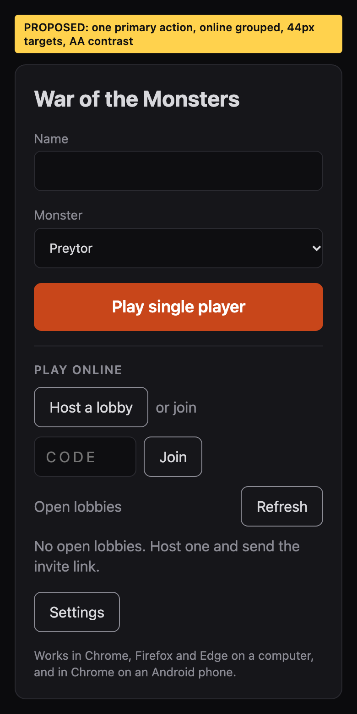
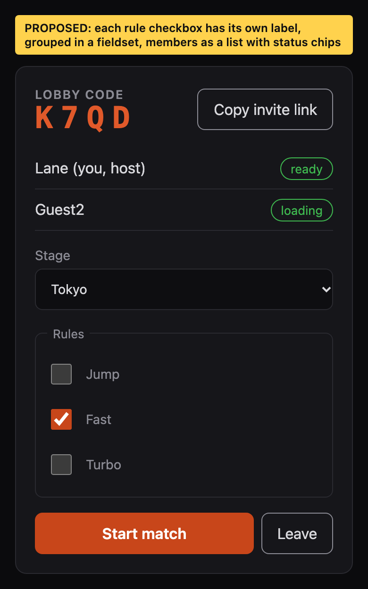
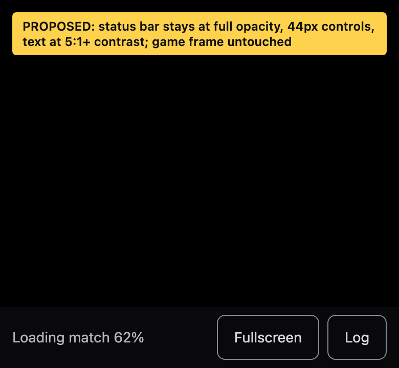

# playwotm.com: visual design audit (2026-11-23)

⚠️ DEGRADED: single-context (this run was told not to spawn sub-agents, and Impeccable's critique normally runs the design review and the detector as two isolated sub-agents). The design review was written with the detector output already in view, so the two are less independent than the skill intends.

Tool: Impeccable 4.10.0 (`pbakaus/impeccable`, Paul Bakaus), engine 0.1.27, user scope, hooks skipped, telemetry off. Mode: **Operate** for the front panel (the visitor completes a task: pick, host or join), with the game canvas as a separate surface that is out of scope. No `PRODUCT.md` or `DESIGN.md` exists and I did not run `/impeccable init`, so this judges the look as shipped.

Evidence:
- Before screenshots from production (`scripts/capture.cjs`, Chromium launched with `--mute-audio`, 2x density), 2026-11-23:
  - Phone 390x844: `screenshots/home-phone.png`, `settings-saves-phone.png`, `settings-controls-phone.png`, `game-start-phone.png`
  - Desktop 1440x900: `screenshots/home-desktop.png`, `settings-saves-desktop.png`, `settings-controls-desktop.png`, `game-start-desktop.png`
  - `game-start-*` shows the first thing "Single player" produces (the publisher intro movie). I did not play, and nothing was audible. The online lobby view needs a second player and a server lobby, so it is not captured; the lobby proposal is a mockup based on `web/index.html:149-167`.
- Detector: `impeccable detect --json` on `web/index.html` (2 findings), and on the live URL at 390x844 (6 findings) and 1440x900 (4 findings).

## Detector results

| Rule | Severity | Detail |
|------|----------|--------|
| low-contrast | warning | white `#ffffff` on accent `#e0592a`: 3.7:1, needs 4.5:1 (`.main` buttons) |
| low-contrast | advisory | dim `#7a7a82` on panel `#16161a`: 4.2:1, plus 5 to 6 more elements |
| low-contrast | warning (live) | `#727275` on `#0b0b0d`: 4.1:1 (the dimmed status bar text), plus one more |
| low-contrast | advisory (live) | `CODE` placeholder 4.2:1 |
| straggler | advisory (phone only) | "link." and "slow)." alone on the last line |

All contrast values match my own calculation in the Modern Web Guidance audit (finding 7). The source scan of a single HTML file cannot see styles that `front.js` applies, so it is a subset.

## Design health (heuristics, scored 0-4 by me)

| # | Heuristic | Score | Key issue |
|---|-----------|-------|-----------|
| 1 | Visibility of system status | 2 | Status bar is at half opacity and 23px tall; progress is easy to miss |
| 2 | Match system and real world | 3 | Plain, clear verbs (Single player, Host online, Join) |
| 3 | User control and freedom | 3 | Back buttons and Esc everywhere; focus return is uneven |
| 4 | Consistency and standards | 3 | One card style across Home, Settings, Report |
| 5 | Error prevention | 3 | Delete confirm exists; it focuses the destructive button |
| 6 | Recognition rather than recall | 3 | Settings tab names are clear; controls need a table lookup |
| 7 | Flexibility and efficiency | 3 | Invite links, remembered name; no quick rematch entry on Home |
| 8 | Aesthetic and minimalist design | 3 | Calm and tidy; no brand moment at all |
| 9 | Error recovery | 3 | Plain messages, retry text |
| 10 | Help and documentation | 3 | "Works in Chrome..." note, device note |
| | **Total** | **29/40** | Good |

## Design specificity verdict

The front panel is clean, consistent and fast, and is also category-interchangeable: a dark card with system-ui type and one orange button could front any web game. The product has strong character (giant monsters, a beloved PS2 cult game, a fan preservation project) and none of it reaches the page before the game starts. The first impression is a generic form, then the original game's intro movie plays, so the best-looking thing a visitor sees is somebody else's logo (`screenshots/game-start-desktop.png`). I would keep the restraint, which suits Operate mode, and add one authored moment: the chosen monster shown large on the card, a title lockup instead of a plain `h1`, and the orange used as a deliberate signal rather than only a button fill. The mockups keep the existing structure and strings.

## Priority issues

### P1. First screen has no identity and no monster
`screenshots/home-desktop.png`: a 440px card centered on a black page, eight controls, no imagery. The monster `<select>` (`index.html:136`) is the most characterful choice in the product and is presented as a dropdown with no picture. Proposal 1 shows the pick as a large portrait with the same select behind it. I have not checked which monster art can legally or practically be shown; the repo has a `levelpics/` folder, which I did not inspect.

### P2. Three equal-weight ways to play
Single player, Host online, Join and Open lobbies sit at similar visual weight, and "or" between Host and CODE is a dim 12px word (`index.html:142`). A visitor who wants to join a friend (the invite-link path) lands on the same screen as a solo player. Proposal 1 groups "Play online" under its own heading and keeps one filled primary button.

### P3. Low-contrast secondary text and the CTA
Dim text is 4.2:1 on the panel and the white-on-orange button is 3.7:1 (both verified). Proposal 1 swaps to `#8b8b94` (5.3:1) and a deeper orange `#c8461a` (4.8:1 with white) for fills, keeping `#e0592a` for text and accents on the panel (4.8:1).

### P4. Status bar disappears
`#bar` sits at 50% opacity in the bottom corner (`index.html:50-52`), carries the load status, Fullscreen and Log, and is about 2:1 effective contrast (see the faint line at the bottom of `home-phone.png`). Proposal 3.

### P5. Small, dense controls on phone
Buttons are 23 to 26px high at 390px, in a layout that wraps awkwardly ("Host online or [CODE] Join" on one row, "Open lobbies [Refresh]" on the next, `home-phone.png`). 44px controls and one control per row for the join flow fix both.

### P6. Lobby rules look like one control
In the lobby, "Jump Fast Turbo" are three checkboxes in one label run together (`index.html:157-158`), and two have no accessible name (see the Modern Web Guidance audit, finding 1). Proposal 2 turns them into a labelled group of rows, shows members as a list with status chips, and keeps Start as the single filled button.

## Strengths
1. Honest, calm copy: "No open lobbies. Host one and send the invite link." says what to do next.
2. Settings is well organized: six clear tabs, a short note that settings save as you change them, `Back` always top right.
3. Everything is on one card style and scales to phone without horizontal scroll (`settings-controls-phone.png`).

## Persona red flags
- **Friend following an invite link on a phone:** lands on a solo-first form with small targets, must type a name, and the status line is nearly invisible while the match loads.
- **Returning player who loves the game:** nothing on the page acknowledges the game; the page looks like a settings dialog.
- **Keyboard or screen-reader user:** Fast and Turbo checkboxes unnamed; the canvas jumps to the front of the tab order (Modern Web Guidance audit, findings 1 and 2).

## UI change proposals (mockups, static HTML rendered to PNG)

Source HTML and renderer are in `mockups/`. All use the page's existing strings; names and the lobby code in mockup 2 are made up for illustration.

### Proposal 1: front panel with one primary action


One filled button for single player, a labelled "Play online" group, 44px controls, AA-contrast dim text and button fill, `color-scheme: dark`. Touches `web/index.html:55,66,138-148` styles and markup. No behavior change.

### Proposal 2: lobby rules and members


Fieldset "Rules" with one label per checkbox, members as a list with status chips, one filled Start button. Touches `web/index.html:149-167` and `web/lobby.js` (not read in depth).

### Proposal 3: status bar you can see


Full-opacity bar with a translucent backdrop and 44px Fullscreen and Log buttons, over the game frame. Touches `web/index.html:50-52,126-127`.

## Reproduce

```sh
cd docs/audits/2026-11-23
NODE_PATH=$(npm root -g) node scripts/capture.cjs screenshots   # launches Chromium with --mute-audio
(cd mockups && NODE_PATH=$(npm root -g) node render.cjs)
DO_NOT_TRACK=1 ~/.claude/skills/impeccable/scripts/impeccable detect --json https://playwotm.com/ --viewport 390x844
```
